# rbac-audit

rbac-audit reads the JSON that `kubectl get roles,rolebindings,clusterroles,clusterrolebindings -A -o json` prints and works out who can do what: which subjects hold `cluster-admin`, which roles use wildcards, which can read every secret, open a shell in pods or change RBAC itself, and which bindings hand rights to anonymous users, every authenticated user or the `default` service account. Findings point at the role or binding by kind and name.



**Live demo:** https://jvch0512.github.io/rbac-audit/ (Synthetic cluster exports.)

Crystal 1.x, standard library only. The demo page is rendered from the tool's `--tsv` output by `scripts/site.py` (Python 3, only needed to regenerate the page).

## Use

```bash
make build
build/rbac-audit examples
build/rbac-audit cluster-rbac.json --tsv
build/rbac-audit ./exports --fail-on high       # exit 1 on any high finding
```

Export with `kubectl get roles,rolebindings,clusterroles,clusterrolebindings -A -o json > rbac.json`. Pass a file or a directory (all `*.json` files, searched recursively).

| Rule | Severity | What it catches |
|---|---|---|
| RBAC001 | critical, high or medium | a binding to `cluster-admin`: critical for anonymous or all authenticated users or all service accounts, high for a service account, medium for other users and groups |
| RBAC002 | high | a role with `*` verbs on `*` resources |
| RBAC003 | high or medium | a role that can read secrets (`get`, `list`, `watch` or `*`): high in a `ClusterRole`, medium in a `Role` |
| RBAC004 | high | a role that can `create` on `pods/exec`, `pods/attach` or `nodes/proxy`, or create pods with `*` |
| RBAC005 | high | the verbs `escalate`, `bind` or `impersonate` |
| RBAC006 | medium | a role that can create or change roles and bindings |
| RBAC007 | medium | a binding that gives rights to a `default` service account |
| RBAC008 | critical | any binding to `system:anonymous` or `system:unauthenticated` other than the built-in discovery roles |
| RBAC000 | info | the file is not a Kubernetes list, or is not valid JSON |

See [examples](examples) and [docs/sample-output.txt](docs/sample-output.txt).

## Limits

- It looks at roles and bindings. Admission policies, `NetworkPolicy`, pod security settings and cloud IAM mappings (EKS, GKE, AKS) are outside scope.
- Aggregated cluster roles are read as stored: rules added through `aggregationRule` labels appear only if the export includes the final rules.
- Objects whose name starts with `system:` and the built-in `cluster-admin`, `admin`, `edit` and `view` roles are not flagged as roles. Bindings to them are.
- `resourceNames` restrictions are ignored, so a rule limited to one secret is still reported as a secret reader.

## Where it fits

Kubernetes security reviews, CIS benchmark work and pre-audit evidence gathering: a fast first pass over who holds power in a cluster.

## Tests

```bash
make test    # Crystal specs: role and binding rules on good and bad input, JSON shapes, hostile input, 3000-case fuzzing and CLI exit codes
```

MIT.

## Code scanning (SARIF)

`scripts/tsv2sarif.py` converts the `--tsv` output into SARIF 2.1.0, so findings show up in GitHub code scanning:

```sh
build/rbac-audit examples --tsv | python3 scripts/tsv2sarif.py --tool rbac-audit --prefix examples > results.sarif
```

Upload `results.sarif` with `github/codeql-action/upload-sarif`. Severities map to SARIF levels (critical and high to error, medium to warning, low and info to note) and to a `security-severity` score.
